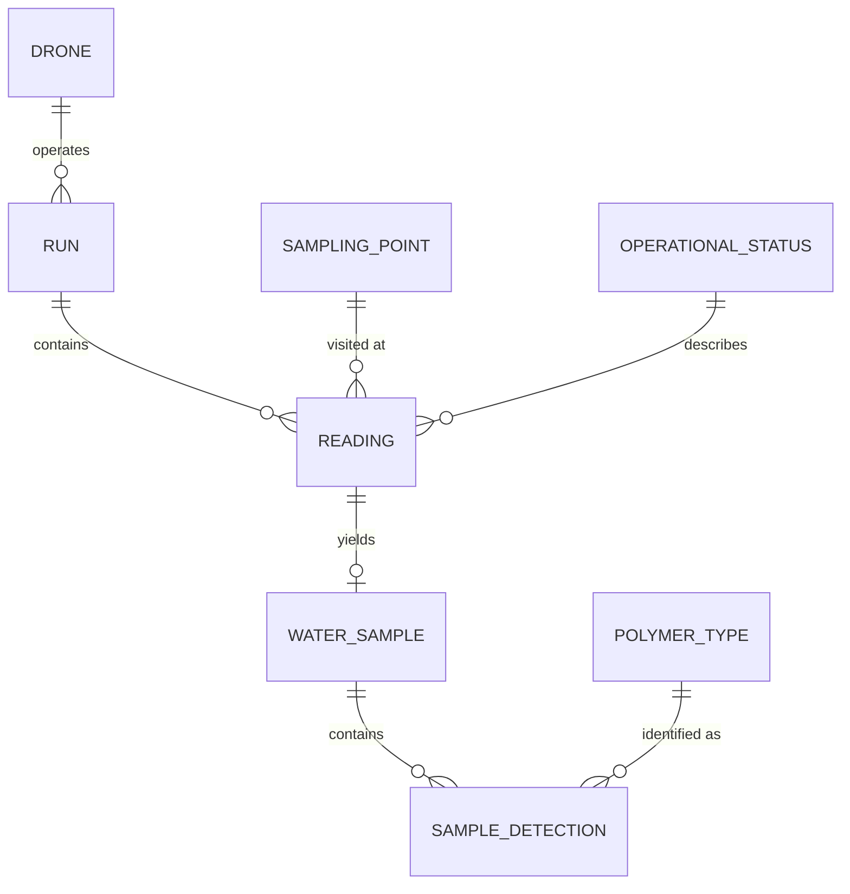
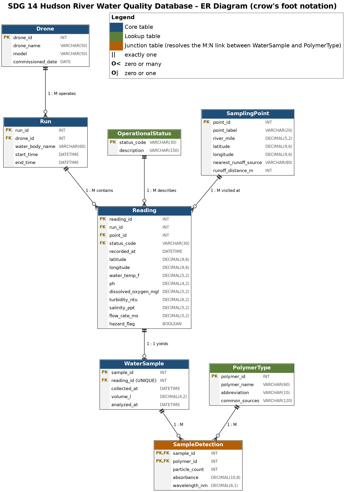

# SDG 14 Hudson River Water Quality Database

  

A relational database supporting a water drone that monitors water quality and microplastics in the Hudson River, in support of UN Sustainable Development Goal 14: Life Below Water.

## Team

| Member               | Focus area                     |
| -------------------- | ------------------------------ |
| Justin Reichelt      | normalization & relationships  |
| Prerit Acharya       | optional relationships & joins |
| Hendrik Vanwingerden | data types & constraints       |
| Josiah Maddicks      | requirements & schema design   |

## Database at a glance



### Full ER diagram

[](diagrams/ER_Diagram_SDG14.png)

_Click the diagram to open it full size._


## Repository layout

```
diagrams/    ER diagrams (final and rough draft)
documents/   project plan, guidance, key terms, status report
sql-files/   schema, mock data, and queries
```

## Getting started

Run the scripts in order from a MySQL 8 client:

```sql
SOURCE sql-files/SDG14_create_tables.sql;
SOURCE sql-files/SDG14_insert_mock_data.sql;
SOURCE sql-files/SDG14_queries.sql;
```

The first script drops and recreates the `sdg14_hudson` database, so all three can be re-run safely.

## Status

- [x] ER diagram
- [x] Schema (DDL)
- [x] Mock data
- [x] Queries
- [ ] Data dictionary
- [ ] Indexes
- [ ] Normalization
- [ ] Project definition
- [ ] DBMS justification


